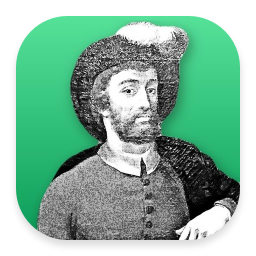
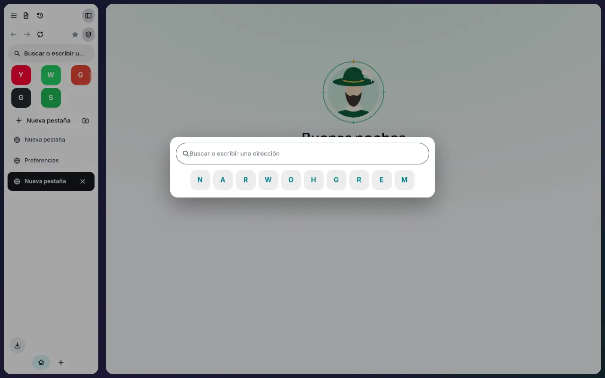
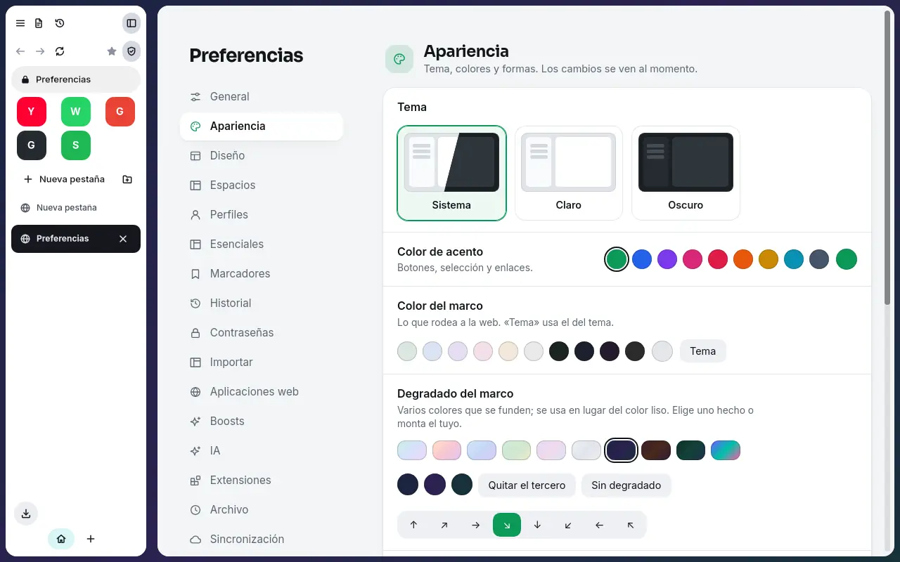
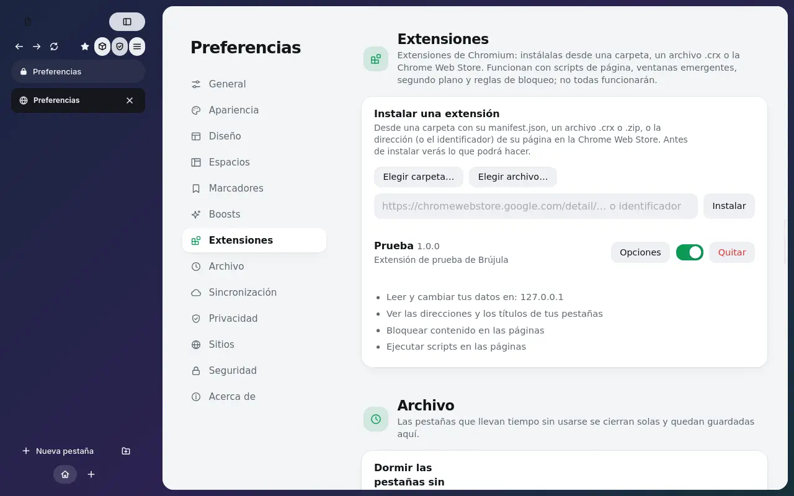
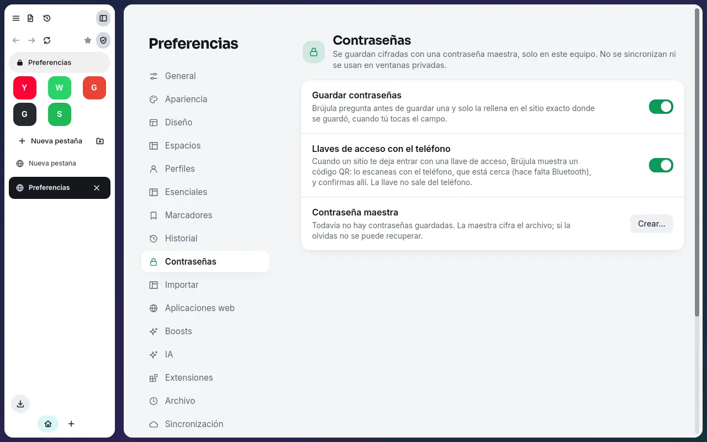
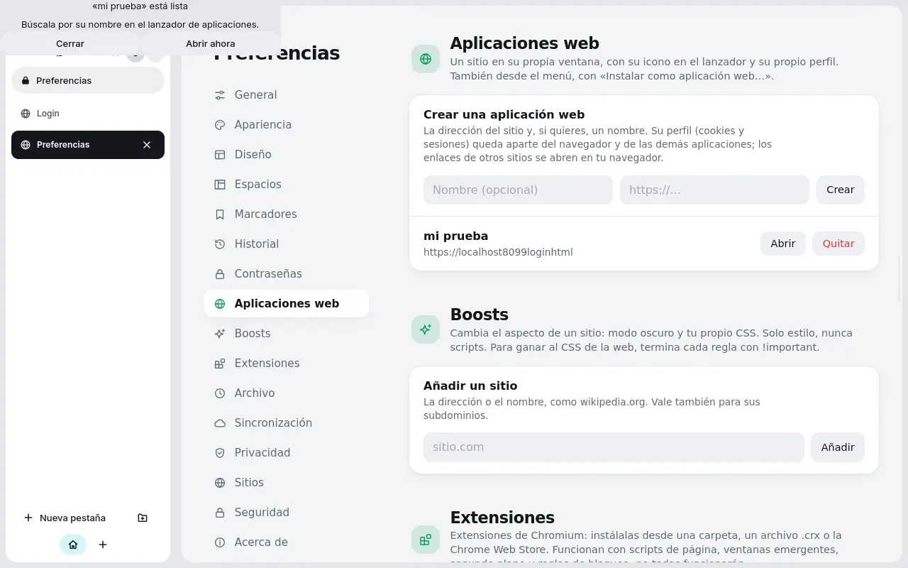
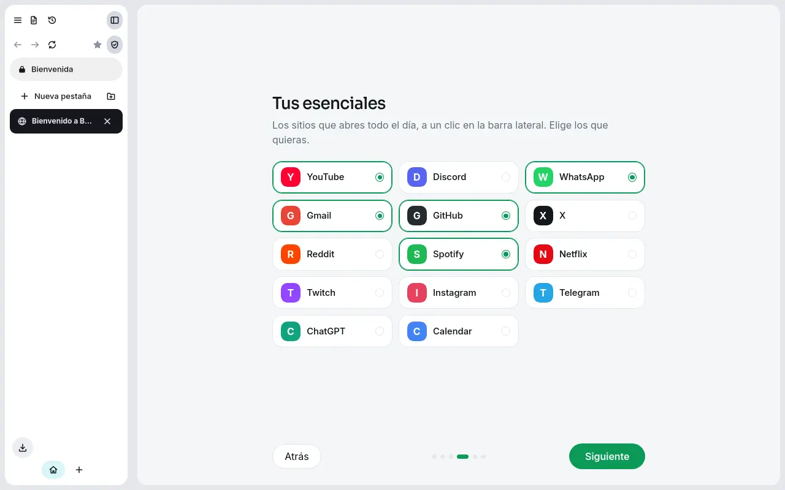
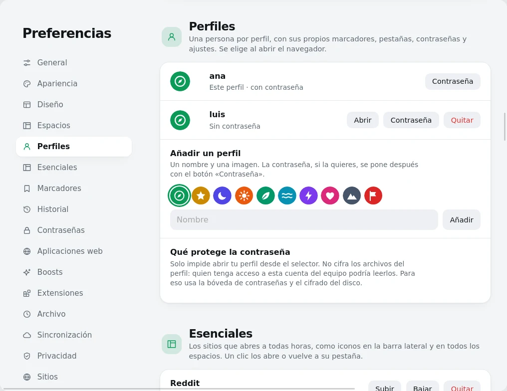

<div align="center">
  <a href="https://getnodalia.com">
    
  </a>
  <br><br>
  
  <h1>Brújula</h1>
  <p><strong>El navegador de Nodalix: rápido, seguro y a tu manera.</strong></p>

  <p>
    <a href="https://github.com/getnodalia/brujula/releases/latest"></a>
    
    
    
    
  </p>

  <p>
    <a href="https://getnodalia.com/brujula/">Web</a> ·
    <a href="#qué-trae">Qué trae</a> ·
    <a href="#instalar">Instalar</a> ·
    <a href="#capturas">Capturas</a> ·
    <a href="#desarrollar">Desarrollar</a>
  </p>
</div>

---

<p align="center">
  
</p>

WebKitGTK 6, interfaz con el [Nodalia Design Language](https://github.com/danielmigueltejedor/nodalia-design)
(`nodalia-gtk`), pestañas verticales o horizontales, espacios, un bloqueador de anuncios propio,
contraseñas cifradas y compatibilidad con extensiones de Chromium. Escrito en Rust.
Solo Linux (GTK 4.20 o más y WebKitGTK 6.0).

## Qué trae

- **Rápido y ligero**: WebKit, pestañas que se duermen solas, la sesión se carga bajo demanda.
- **Seguro**: HTTPS primero, certificados malos nunca se saltan, programas y scripts solo se descargan si lo confirmas (sin permiso de ejecución), cada descarga se analiza al llegar, permisos denegados por defecto, ITP activado.
- **Esenciales**: los sitios de todos los días (YouTube, Discord, correo…) como iconos en la barra lateral, en todos los espacios.
- **Bienvenida y perfiles**: la primera vez, un asistente (en el idioma del sistema) importa marcadores, historial, cookies y contraseñas de Chrome, Chromium, Brave, Edge, Vivaldi, Opera, Firefox, Zen… (o marcadores y contraseñas de un archivo; las contraseñas de Firefox, desde su CSV exportado), ofrece hacerlo navegador predeterminado y elegir esenciales, y crea tu usuario. Cada persona del equipo puede tener su perfil (marcadores, pestañas, contraseñas y ajustes aparte) y se elige al abrir, como en una plataforma de vídeo. La contraseña de un perfil solo protege el selector: no cifra sus archivos.
- **Bloqueador de anuncios** con listas EasyList, EasyPrivacy y uBlock (reglas de red de WebKit, reglas cosméticas y scriptlets), activable por sitio.
- **Personalizable**: tema, acento, marco con degradados, redondeo, separación, disposición (islas, marco, vertical, horizontal), espacios con icono, Boosts (CSS por sitio), buscador a elegir.
- **Extensiones de Chromium**: scripts de contenido, fondo, ventana emergente, opciones, almacenamiento, mensajes, reglas de bloqueo… Se instalan desde una carpeta, un `.crx` o la Chrome Web Store (botón «Añadir esta extensión» en su ficha), con un aviso de permisos. No todas las extensiones funcionarán: ver [docs/brujula-rust.md](docs/brujula-rust.md).
- **Sincronización** de marcadores, espacios y pestañas por una carpeta (Dropbox, Nextcloud, iCloud Drive…) o una cuenta de Nodalix.
- **Contraseñas** guardadas cifradas (Argon2id + XChaCha20-Poly1305) con una contraseña maestra, que solo se rellenan en el sitio exacto y al tocar el campo. La clave se guarda en el llavero del sistema, así que se desbloquean solas al iniciar sesión sin pedir la maestra (se puede desactivar).
- **Llaves de acceso con el teléfono**: cuando un sitio te deja entrar con una llave de acceso (passkey), Brújula muestra un código QR; lo escaneas con el teléfono, que está cerca (hace falta Bluetooth), y confirmas allí con tu huella, tu cara o tu PIN. La llave no sale del teléfono. Se apaga en Preferencias → Contraseñas.
- **Aplicaciones web**: cualquier sitio en su propia ventana, con icono en el lanzador y perfil aparte (menú → «Instalar como aplicación web…», o el botón que aparece en la barra cuando el sitio lo permite).
- **Historial** local, con búsqueda en el Spotlight y borrado por horas o completo, y **ventana privada** (Ctrl+Mayús+N o `brujula --private`) que no guarda historial, cookies ni pestañas.
- **Asistente de IA opcional** (apagado por defecto): ChatGPT, Claude, Gemini, Ollama o tu propio servidor, con tu clave en el llavero. Puede ver tus pestañas, leer páginas y abrir sitios solo con tu permiso, y puede encargarse del buscador. Ver [docs/ai-assistant.md](docs/ai-assistant.md).
- **DRM (Netflix, Disney+, Spotify…)**: WebKitGTK no lo puede reproducir; Brújula avisa y abre la página en un navegador con Widevine (Chrome, Edge, Firefox…). Ver [docs/drm.md](docs/drm.md).
- **Herramientas de página**: buscar en la página (Ctrl+F), zoom que se recuerda por sitio (Ctrl +/−/0), silenciar una pestaña (clic en el altavoz o Ctrl+M), copiar el enlace (Ctrl+Mayús+C), capturar la página (Ctrl+Mayús+S, a Imágenes y al portapapeles), imprimir (Ctrl+P), pantalla completa (F11), inspector (F12) y Ctrl+1…9 para ir a una pestaña. Todo está también en el Spotlight como comandos («capt», «zoom»…) y en el menú → Página.
- Arc-isms: archivo automático, vista dividida, Peek (Mayús+clic), notas por espacio, ventana flotante.

## Instalar

**AppImage** (x86_64): descárgala de la [última versión](https://github.com/getnodalia/brujula/releases/latest), hazla ejecutable y ábrela. Necesita una distribución con una glibc tan reciente como la de Arch (Arch, CachyOS, Nodalix…).

```sh
chmod +x Brujula-*-x86_64.AppImage
./Brujula-*-x86_64.AppImage
```

**Arch o CachyOS**, compilándola:

```sh
cd packaging/arch && makepkg -si
```

**Desde el código**, con las dependencias (`gtk4`, `webkitgtk-6.0`, `libsoup3`) y Rust 1.85 o más:

```sh
cargo install --path crates/brujula --root ~/.local --locked
```

## Capturas

<table>
  <tr>
    <td></td>
    <td></td>
  </tr>
  <tr>
    <td></td>
    <td></td>
  </tr>
  <tr>
    <td></td>
    <td></td>
  </tr>
</table>

## Desarrollar

`docs/brujula-rust.md` explica la estructura, las decisiones, cómo compilar y probar y qué está
verificado y qué no. `crates/brujula-core` no tiene interfaz y se prueba con `cargo test -p brujula-core`.

## La suite Nodalia

Brújula es una de las aplicaciones de [Nodalia](https://getnodalia.com), un proyecto de software
independiente desarrollado en público por [Daniel Miguel Tejedor](https://danielmigueltejedor.com), y
el navegador de [Nodalix OS](https://github.com/getnodalia/nodalix-os).

## Licencia

GPL-3.0-or-later. El repositorio conserva el código de GNOME Web (Epiphany), de donde partió.
